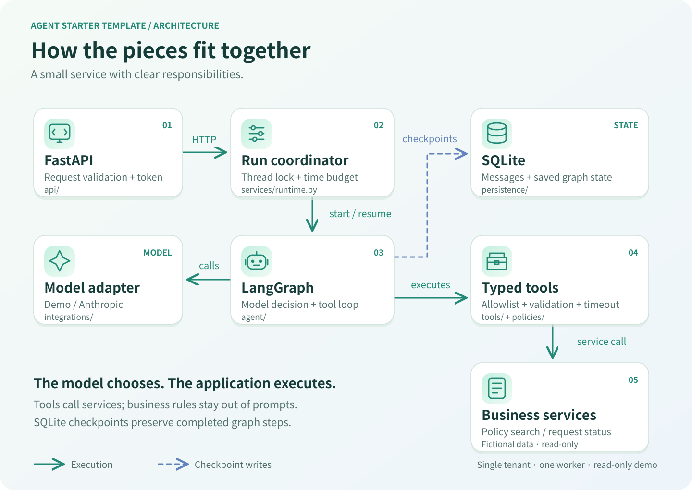
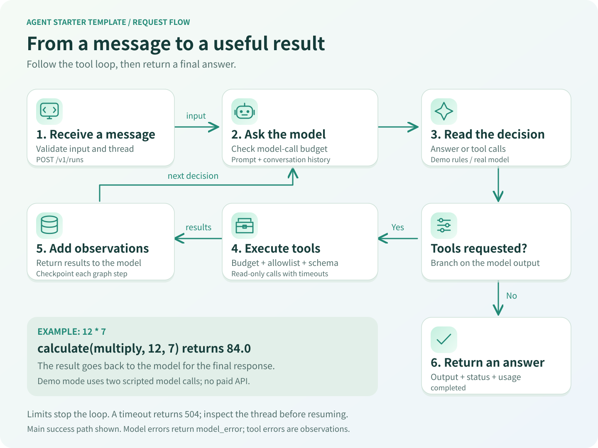

<div align="center">

# Agent Starter Template

**From a tool-calling prototype to a testable, stateful service.**

A small Python foundation with explicit boundaries, bounded execution, and a working API.

[](https://github.com/hyunolike/agent-starter-template/actions/workflows/ci.yml)
[](https://www.python.org/)
[](https://fastapi.tiangolo.com/)
[](https://docs.langchain.com/oss/python/langgraph/overview)
[](LICENSE)

**English** · [한국어](docs/README.ko.md)

[Quick start](#quick-start) · [Architecture](#architecture) · [Extend](docs/EXTENDING.md) · [Report a bug](https://github.com/hyunolike/agent-starter-template/issues/new/choose)

</div>

## Why this template?

Start with one agent, a few useful tools, and an API you can test. Keep model decisions separate from business rules and external integrations as your project grows.

The included assistant searches **fictional internal policies**, checks **synthetic request records**, and performs arithmetic. Its read-only tools demonstrate the extension points without requiring a database service or external API key.

> **Demo first.** The default `demo` provider is a deterministic scripted adapter, not an LLM. It exercises the real API, graph, tools, and SQLite persistence. Select `anthropic` to use a real model. This is a starter for a single tenant and one worker, not a finished multi-user platform.

## Contents

- [Features](#features)
- [Quick start](#quick-start)
- [Use a real model](#use-a-real-model)
- [Architecture](#architecture)
- [Request flow](#request-flow)
- [API](#api)
- [Configuration](#configuration)
- [Development and evaluation](#development-and-evaluation)
- [Docker](#docker)
- [Use as a template](#use-as-a-template)
- [Scope and roadmap](#scope-and-roadmap)
- [Contributing](#contributing)
- [Acknowledgments](#acknowledgments)

## Features

| Capability | Included behavior |
| --- | --- |
| Agent loop | Explicit LangGraph model → tools → model loop |
| Typed tools | Pydantic validation, registry allowlist, read-only examples |
| Persistence | Async SQLite checkpoints and conversation continuity |
| Recovery | Inspect and resume unfinished checkpointed runs |
| Limits | Model calls, tool attempts, tool timeouts, run timeout, history admission limit |
| API | FastAPI, OpenAPI docs, optional shared bearer token |
| Concurrency | Reject overlapping runs on the same thread in one process |
| Visibility | Structured application logs and response-level usage/tool metadata |
| Verification | Unit/integration tests and deterministic demo contract evaluations |
| Delivery | Locked dependencies, Docker, GitHub Actions, English/Korean README |

## Quick start

Requires **Python 3.11–3.13** and [uv](https://docs.astral.sh/uv/getting-started/installation/).

```bash
git clone https://github.com/hyunolike/agent-starter-template.git
cd agent-starter-template
uv sync --frozen
cp .env.example .env
uv run agent-starter
```

On PowerShell, replace `cp` with `Copy-Item .env.example .env`. The server listens on `127.0.0.1:8000`.

Open [Swagger UI](http://127.0.0.1:8000/docs), or try:

```bash
curl http://127.0.0.1:8000/v1/runs \
  -H 'Content-Type: application/json' \
  -d '{"message":"12 * 7"}'
```

Example response (IDs vary):

```json
{
  "run_id": "0149235e-6170-4bf7-a1b5-68f419dc4c21",
  "thread_id": "a3c4372c-0909-48c5-93ac-6e18d95ac781",
  "status": "completed",
  "output": "Demo tool result: {\"result\": 84.0}",
  "model_provider": "demo",
  "model_calls": 2,
  "tool_calls": 1,
  "tool_events": [{"name": "calculate", "error": null}],
  "input_tokens": 0,
  "output_tokens": 0
}
```

Try `MFA`, `보안`, `REQ-1001`, or `10 / 0`. Demo arithmetic accepts two numbers with `+`, `-`, `*`, or `/`. Other messages use keyword search; the demo does not understand general natural language.

To continue a conversation, send its returned `thread_id` in the next request. In demo mode, send `history` with that ID to see previous user messages. Restarting the server preserves those messages in SQLite.

## Use a real model

Edit `.env`:

```dotenv
AGENT_MODEL_PROVIDER=anthropic
AGENT_MODEL_NAME=claude-sonnet-4-6
ANTHROPIC_API_KEY=your-key-here
```

Restart the server and ask a natural-language question, such as “Find the demo MFA policy and cite its source.” The model chooses among the same three tools. Model availability depends on your provider account; change the model name as needed.

Real requests incur provider charges. CI and default evaluations never call a paid model. The adapter is tested for construction/tool binding; live provider behavior requires your own key and validation. See [extension guidance](docs/EXTENDING.md) for other providers.

## Architecture



The API receives the request; the coordinator starts the graph. The graph calls the model and tools, and saves state. **The model selects tools; the application executes them.**

| Path | Responsibility |
| --- | --- |
| `src/agent_app/api/` | HTTP routes, authentication, request/response contracts |
| `src/agent_app/agent/` | Graph, state, and versioned system prompt |
| `src/agent_app/tools/` | Tool descriptions, schemas, thin adapters |
| `src/agent_app/services/` | Business rules and run coordination |
| `src/agent_app/integrations/` | Demo and Anthropic model adapters |
| `src/agent_app/policies/` | Tool allowlist enforcement and timeout handling |
| `src/agent_app/persistence/` | SQLite checkpointer lifecycle |
| `src/agent_app/observability/` | Structured application logs |
| `src/agent_app/data/` | Packaged fictional knowledge corpus |
| `tests/` | Tool, API, persistence, concurrency, and limit tests |
| `evals/` | Deterministic input/expected-behavior cases |

Business rules belong in services. Tools expose those services to the model. Prompts guide behavior; code enforces tool access and execution limits. See [design decisions](docs/ARCHITECTURE.md).

## Request flow



For `12 * 7`, the calculator returns `84.0`. That observation goes back to the model to produce the final response. New tools reuse this same loop.

## API

| Method | Endpoint | Purpose |
| --- | --- | --- |
| `GET` | `/healthz` | Public liveness and selected provider; no model request |
| `POST` | `/v1/runs` | Run a message; optionally continue a `thread_id` |
| `GET` | `/v1/threads/{thread_id}` | Inspect message count, status, and pending work |
| `POST` | `/v1/threads/{thread_id}/resume` | Resume unfinished work without appending a message |
| `GET` | `/docs` | Interactive API documentation |

Set `AGENT_API_TOKEN` to require `Authorization: Bearer <token>` on all `/v1` routes. It is a **shared single-tenant token**, not user-level authentication or thread ownership. Keep the unauthenticated default on localhost.

Responses use `completed`, `limit_reached`, or `model_error`; clients must inspect `status`, even on HTTP 200. A completed run can contain a handled tool error, visible in `tool_events`.

HTTP errors include 401 (authentication), 404 (unknown thread), 409 (busy, resume required, no pending work, or history limit), 422 (invalid input), and 504 (run timeout). Runtime errors return `detail.code` and `detail.thread_id`.

After a timeout, inspect the returned thread ID. If `pending` is true, resume it:

```bash
curl -X POST http://127.0.0.1:8000/v1/threads/THREAD_ID/resume
```

Resuming preserves saved counters and may replay an incomplete node. Only read-only tools are included. A new message is rejected while unfinished work exists. Each resume request gets a new wall-clock timeout; interrupted provider attempts may incur usage not present in saved counters. There is no exactly-once execution guarantee.

## Configuration

Environment variables override `.env`. Never commit real credentials.

| Variable | Default | Purpose |
| --- | --- | --- |
| `AGENT_MODEL_PROVIDER` | `demo` | `demo` or `anthropic` |
| `AGENT_MODEL_NAME` | `claude-sonnet-4-6` | Real model identifier |
| `ANTHROPIC_API_KEY` | empty | Provider credential; real mode only |
| `AGENT_API_TOKEN` | empty | Optional shared API bearer token |
| `AGENT_DATABASE_PATH` | `var/checkpoints.sqlite` | Durable local checkpoint file |
| `AGENT_MAX_MODEL_CALLS` | `5` | Graph-level model calls per turn |
| `AGENT_MAX_TOOL_CALLS` | `8` | Tool attempts per turn, including rejected/failed calls |
| `AGENT_RUN_TIMEOUT_SECONDS` | `60` | Time budget per run/resume invocation |
| `AGENT_TOOL_TIMEOUT_SECONDS` | `10` | Time budget per async tool invocation |
| `AGENT_MAX_HISTORY_MESSAGES` | `200` | Reject a new turn when stored history reaches this size |

History is checked **between turns**, not truncated mid-turn. Start a new thread when the admission limit is reached. The provider adapter allows one retry for transient model errors; tool calls are not automatically retried. Async tool timeouts require cooperative async code; they cannot kill blocking CPU work.

## Development and evaluation

```bash
uv run ruff check .
uv run ruff format --check .
uv run pytest -q
uv run python evals/evaluate.py
uv build
```

Optional Make targets: `make dev`, `make test`, `make lint`, `make eval`, `make check`.

The seven demo cases verify tool routing, arithmetic, source IDs, empty evidence, and missing records. **They are contract checks, not an LLM quality benchmark.** For a real model, add repeated trials, domain-specific expected outcomes, and calibrated graders. [Evaluation guide →](docs/EVALUATION.md)

GitHub Actions runs lint, tests, evaluations, and package builds on Python 3.11–3.13, plus a Docker build and HTTP smoke test. CI status is shown in the live badge above.

## Docker

```bash
cp .env.example .env
docker compose up --build
```

Compose binds to localhost and persists SQLite in the `checkpoints` named volume. The container runs as a non-root user with one Uvicorn worker. `docker compose down` preserves the volume; adding `-v` deletes saved conversations.

## Use as a template

1. If GitHub shows **Use this template**, create your own repository from it. Otherwise clone or fork this repository. The owner can enable **Template repository** in Settings → General.
2. Rename the distribution and package as needed; update repository links, badges, and attribution.
3. Replace the fictional knowledge and request service with your own data source.
4. Add typed tools and corresponding tests/evaluation cases.
5. Update both this README and [the Korean README](docs/README.ko.md).

Follow the [tool extension walkthrough](docs/EXTENDING.md).

## Scope and roadmap

**Implemented:** single-agent execution, read-only tools, SQLite persistence, resume, limits, optional shared-token auth, logs, tests, demo evaluations, packaging, and CI.

**Optional next steps, not implemented:**

- [ ] PostgreSQL checkpointer and distributed concurrency control
- [ ] Per-user authentication, thread ownership, and retention/deletion APIs
- [ ] Write-tool approvals, idempotency, and audit records
- [ ] Retrieval/vector-store and MCP integration examples
- [ ] Streaming responses and task cancellation API
- [ ] Real-model quality evaluation suite and external tracing integration

Run **one application worker against each SQLite file**. Before exposing a real multi-user service, add identity/authorization, request limiting, durable concurrency control, and a data-retention policy. SQLite stores conversation content on disk; structured application logs omit message/tool payloads, but this does not replace data access controls. Review any provider or third-party tracing configuration separately.

## Contributing

See [CONTRIBUTING.md](CONTRIBUTING.md). Small, testable changes with matching documentation are welcome. See [SECURITY.md](SECURITY.md) for security reporting guidance.

## Acknowledgments

- [Best-README-Template](https://github.com/othneildrew/Best-README-Template) — inspiration for README navigation, setup, usage, and contribution sections.
- [LangChain Simple Agent Template](https://github.com/langchain-ai/simple-agent-template) — reference for a small, runnable agent starter.
- [LangGraph quickstart](https://docs.langchain.com/oss/python/langgraph/quickstart) and [persistence](https://docs.langchain.com/oss/python/langgraph/persistence) — graph and checkpoint concepts.
- [Anthropic: Building effective agents](https://www.anthropic.com/engineering/building-effective-agents) — simple, composable agent patterns.

## License

[MIT](LICENSE) © 2026 hyunolike.
