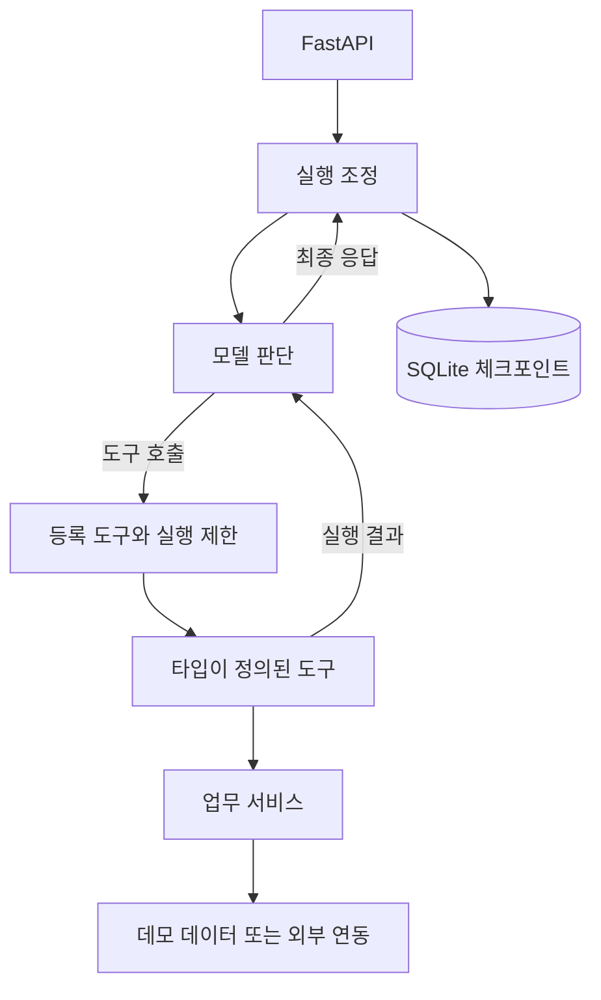

<div align="center">

# Agent Starter Template

**도구 호출 프로토타입에서 테스트 가능한 상태 기반 서비스까지.**

명확한 책임 분리, 실행 제한, 동작하는 API를 갖춘 Python 에이전트 템플릿입니다.

[](https://github.com/hyunolike/agent-starter-template/actions/workflows/ci.yml)
[](https://www.python.org/)
[](../LICENSE)

[English](../README.md) · **한국어**

[빠른 시작](#빠른-시작) · [구조](#구조) · [확장 가이드](EXTENDING.md) · [버그 신고](https://github.com/hyunolike/agent-starter-template/issues/new/choose)

</div>

## 소개

에이전트 하나와 몇 가지 도구, 테스트 가능한 API로 시작합니다. 모델의 판단, 업무 규칙, 외부 연동을 분리해 프로젝트가 커져도 확장하기 쉽도록 구성했습니다.

예제 에이전트는 **가상의 사내 정책 검색**, **가상 요청 상태 조회**, **사칙연산**을 수행합니다. 외부 서비스나 API 키 없이 실행 구조를 확인할 수 있습니다.

> 기본 `demo` 모드는 규칙 기반 어댑터이며 LLM이 아닙니다. 실제 API·그래프·도구·SQLite 저장 흐름을 검증하기 위한 모드입니다. 실제 모델은 `anthropic`으로 전환하세요. 단일 테넌트·단일 워커용 시작 템플릿이며, 완성된 다중 사용자 서비스는 아닙니다.

## 목차

- [주요 기능](#주요-기능)
- [빠른 시작](#빠른-시작)
- [실제 모델 사용](#실제-모델-사용)
- [구조](#구조)
- [API](#api)
- [환경 설정](#환경-설정)
- [개발과 평가](#개발과-평가)
- [Docker](#docker)
- [템플릿 사용](#템플릿-사용)
- [현재 범위와 로드맵](#현재-범위와-로드맵)

## 주요 기능

| 기능 | 구현 내용 |
| --- | --- |
| 실행 흐름 | LangGraph 기반 모델 → 도구 → 모델 반복 |
| 도구 | Pydantic 입력 검증, 등록 도구만 허용, 읽기 전용 예제 |
| 상태 저장 | 비동기 SQLite 체크포인트와 대화 유지 |
| 복구 | 미완료 체크포인트 확인 및 재개 |
| 실행 제한 | 모델 호출·도구 시도 횟수, 시간 제한, 대화 길이 기준 신규 요청 제한 |
| API | FastAPI, OpenAPI 문서, 선택형 공용 Bearer 토큰 |
| 동시 실행 | 같은 대화의 중복 실행을 한 프로세스 안에서 차단 |
| 관측 | 구조화된 애플리케이션 로그, 응답의 도구·토큰 사용 정보 |
| 검증 | 단위·통합 테스트, 결정적 데모 평가 |
| 개발 환경 | 잠금 파일, Docker, GitHub Actions, 영문·국문 README |

## 빠른 시작

**Python 3.11–3.13**과 [uv](https://docs.astral.sh/uv/getting-started/installation/)가 필요합니다.

```bash
git clone https://github.com/hyunolike/agent-starter-template.git
cd agent-starter-template
uv sync --frozen
cp .env.example .env
uv run agent-starter
```

PowerShell에서는 `cp` 대신 `Copy-Item .env.example .env`를 사용할 수 있습니다.
서버 주소는 `127.0.0.1:8000`이며, [Swagger UI](http://127.0.0.1:8000/docs)에서 API를 실행할 수 있습니다.

```bash
curl http://127.0.0.1:8000/v1/runs \
  -H 'Content-Type: application/json' \
  -d '{"message":"12 * 7"}'
```

응답에는 `thread_id`, `run_id`, `status`, `output`, 모델·도구 호출 횟수와 토큰 수가 포함됩니다. 위 요청은 `84.0`을 반환하며 데모 모드의 토큰 사용량은 0입니다.

입력 예시: `MFA`, `보안`, `REQ-1001`, `10 / 0`.
데모 계산은 숫자 두 개와 `+`, `-`, `*`, `/`만 지원합니다. 그 외 입력은 키워드 검색으로 처리하며 일반 자연어 추론을 수행하지 않습니다.

다음 요청에 반환된 `thread_id`를 넣으면 대화를 이어갑니다. 같은 ID로 `history`를 보내 이전 사용자 메시지를 확인할 수 있습니다. 서버를 재시작해도 SQLite에 저장된 대화가 유지됩니다.

## 실제 모델 사용

`.env`를 수정하고 서버를 다시 시작하세요.

```dotenv
AGENT_MODEL_PROVIDER=anthropic
AGENT_MODEL_NAME=claude-sonnet-4-6
ANTHROPIC_API_KEY=your-key-here
```

예: “데모 MFA 정책을 찾아 출처와 함께 설명해줘.” 실제 모델이 동일한 세 도구 중 필요한 도구를 선택합니다. 모델 사용 가능 여부는 계정에 따라 다르므로 모델명을 변경할 수 있습니다.

실제 호출에는 제공자 비용이 발생합니다. CI와 기본 평가는 유료 모델을 호출하지 않습니다. 어댑터 생성·도구 바인딩은 테스트하지만 실제 API 응답은 본인의 키로 별도 검증해야 합니다.

## 구조



| 경로 | 책임 |
| --- | --- |
| `src/agent_app/api/` | HTTP, 인증, 요청·응답 계약 |
| `src/agent_app/agent/` | 그래프, 상태, 시스템 프롬프트 |
| `src/agent_app/tools/` | 도구 설명, 입력 스키마, 서비스 호출 |
| `src/agent_app/services/` | 업무 규칙, 실행 조정 |
| `src/agent_app/integrations/` | 데모·Anthropic 모델 어댑터 |
| `src/agent_app/policies/` | 허용 도구 확인, 시간 제한 처리 |
| `src/agent_app/persistence/` | SQLite 체크포인트 생명주기 |
| `src/agent_app/observability/` | 구조화된 애플리케이션 로그 |
| `src/agent_app/data/` | 패키지에 포함되는 가상 문서 |
| `tests/` | 도구·API·복구·동시성·제한 테스트 |
| `evals/` | 입력과 기대 동작을 정의한 데모 평가 |

업무 규칙은 서비스에 두고 도구는 이를 모델에 노출하는 얇은 계층으로 유지합니다. 프롬프트는 행동을 안내하고, 권한과 실행 제한은 코드가 강제합니다. [설계 설명 →](ARCHITECTURE.md)

## API

| 메서드 | 엔드포인트 | 용도 |
| --- | --- | --- |
| `GET` | `/healthz` | 공개 상태 확인. 모델 API를 호출하지 않음 |
| `POST` | `/v1/runs` | 새 메시지 실행 또는 기존 대화 이어가기 |
| `GET` | `/v1/threads/{thread_id}` | 메시지 수·상태·미완료 작업 확인 |
| `POST` | `/v1/threads/{thread_id}/resume` | 메시지 추가 없이 미완료 작업 재개 |
| `GET` | `/docs` | 대화형 API 문서 |

`AGENT_API_TOKEN`을 설정하면 모든 `/v1` 요청에 `Authorization: Bearer <token>`이 필요합니다. 이는 **단일 테넌트 공용 토큰**이며 사용자별 인증·대화 소유권 기능은 아닙니다. 인증 없는 기본 설정은 localhost에서 사용하세요.

HTTP 200이어도 `status`를 확인해야 합니다. 상태는 `completed`, `limit_reached`, `model_error`이며, 완료된 실행에도 처리된 도구 오류가 있을 수 있습니다. 오류는 `tool_events`에서 확인합니다.

HTTP 오류는 401(인증), 404(없는 대화), 409(동시 실행·재개 필요·재개할 작업 없음·대화 길이 제한), 422(잘못된 입력), 504(시간 초과)입니다. 런타임 오류에는 `detail.code`, `detail.thread_id`가 반환됩니다.

시간 초과 후 해당 대화를 조회하여 `pending: true`이면 재개하세요.

```bash
curl -X POST http://127.0.0.1:8000/v1/threads/THREAD_ID/resume
```

재개는 저장된 카운터를 유지하지만 미완료 노드를 다시 실행할 수 있습니다. 따라서 현재는 읽기 전용 도구만 제공합니다. 미완료 작업이 있으면 새 메시지를 거절합니다. 재개 요청마다 시간 제한이 새로 적용되며, 중단된 모델 호출의 비용·시도는 저장된 사용량에 포함되지 않을 수 있습니다. 정확히 한 번 실행을 보장하지 않습니다.

## 환경 설정

환경 변수가 `.env`보다 우선합니다. 실제 비밀값은 Git에 커밋하지 마세요.

| 변수 | 기본값 | 설명 |
| --- | --- | --- |
| `AGENT_MODEL_PROVIDER` | `demo` | `demo` / `anthropic` |
| `AGENT_MODEL_NAME` | `claude-sonnet-4-6` | 실제 모델 식별자 |
| `ANTHROPIC_API_KEY` | 빈 값 | 실제 모델용 API 키 |
| `AGENT_API_TOKEN` | 빈 값 | 선택형 공용 API 토큰 |
| `AGENT_DATABASE_PATH` | `var/checkpoints.sqlite` | 체크포인트 파일 |
| `AGENT_MAX_MODEL_CALLS` | `5` | 턴당 그래프의 모델 호출 수 |
| `AGENT_MAX_TOOL_CALLS` | `8` | 턴당 도구 시도 수. 실패·거부 포함 |
| `AGENT_RUN_TIMEOUT_SECONDS` | `60` | 실행·재개 요청별 제한 시간 |
| `AGENT_TOOL_TIMEOUT_SECONDS` | `10` | 비동기 도구별 제한 시간 |
| `AGENT_MAX_HISTORY_MESSAGES` | `200` | 신규 턴을 거절할 저장 메시지 수 기준 |

메시지 수는 **턴 사이에 검사**하며 진행 중인 턴의 기록을 잘라내지 않습니다. 기준에 도달하면 새 대화를 시작하세요. 모델 제공자의 일시적 오류는 최대 한 번 재시도하며 도구는 자동 재시도하지 않습니다. 비동기 시간 제한은 협력적인 async 코드에 적용되며, 블로킹 CPU 작업을 강제 종료하지는 못합니다.

## 개발과 평가

```bash
uv run ruff check .
uv run ruff format --check .
uv run pytest -q
uv run python evals/evaluate.py
uv build
```

Make 사용 시 `make dev`, `make test`, `make lint`, `make eval`, `make check`를 제공합니다.

7개 데모 시나리오는 도구 선택, 계산, 출처 ID, 근거 없음, 없는 요청을 검증합니다. **실제 LLM 품질 평가 점수가 아닙니다.** 실제 모델에는 반복 실행, 업무별 성공 기준, 보정된 평가 기준을 추가하세요. [평가 가이드 →](EVALUATION.md)

GitHub Actions는 Python 3.11–3.13에서 검사·테스트·평가·패키지 빌드를 실행하고, 별도 작업에서 Docker 빌드와 HTTP 실행을 확인합니다. 실제 결과는 상단 CI 배지에서 확인할 수 있습니다.

## Docker

```bash
cp .env.example .env
docker compose up --build
```

localhost에만 포트를 공개하며 `checkpoints` 볼륨에 대화를 보존합니다. 컨테이너는 비루트 사용자와 Uvicorn 워커 1개로 실행합니다. `docker compose down`은 볼륨을 보존하지만 `-v`를 추가하면 저장된 대화를 삭제합니다.

## 템플릿 사용

1. **Use this template** 버튼이 있으면 새 레포를 만드세요. 없으면 clone/fork로 시작할 수 있으며 소유자는 Settings → General에서 **Template repository**를 활성화할 수 있습니다.
2. 프로젝트·패키지 이름, 레포 링크·배지·저작권 표기를 조정하세요.
3. 가상 문서와 요청 서비스를 실제 데이터 소스로 교체하세요.
4. 타입이 정의된 도구와 테스트·평가 사례를 추가하세요.
5. [영문 README](../README.md)와 이 문서를 함께 갱신하세요.

[도구 확장 예제 →](EXTENDING.md)

## 현재 범위와 로드맵

**구현 완료:** 단일 에이전트, 읽기 전용 도구, SQLite 저장, 재개, 실행 제한, 선택형 공용 토큰, 로그, 테스트, 데모 평가, 패키징, CI.

**미구현 선택 확장:**

- [ ] PostgreSQL 체크포인트와 분산 동시성 제어
- [ ] 사용자별 인증·대화 소유권·보관 및 삭제 API
- [ ] 쓰기 도구 승인·멱등성·감사 기록
- [ ] RAG·벡터 저장소·MCP 연동 예제
- [ ] 스트리밍과 작업 취소 API
- [ ] 실제 모델 품질 평가·외부 트레이싱 연동

SQLite 파일 하나당 **애플리케이션 워커 하나**를 사용하세요. 실제 다중 사용자 서비스로 공개하려면 사용자 인증·권한, 요청 제한, 영속 동시성 제어, 데이터 보관 정책을 추가해야 합니다. SQLite에는 대화 내용이 저장됩니다. 애플리케이션 로그는 메시지·도구 페이로드를 제외하지만 저장 데이터 접근 제어를 대체하지 않습니다. 제공자나 외부 트레이싱 설정도 별도로 확인하세요.

## 기여와 참고 자료

[기여 안내](../CONTRIBUTING.md) · [보안 안내](../SECURITY.md)

README 구성은 [Best-README-Template](https://github.com/othneildrew/Best-README-Template), 최소 에이전트 구성은 [LangChain Simple Agent Template](https://github.com/langchain-ai/simple-agent-template)을 참고했습니다. [LangGraph 공식 문서](https://docs.langchain.com/oss/python/langgraph/overview)와 [Anthropic 설계 가이드](https://www.anthropic.com/engineering/building-effective-agents)도 참고 자료입니다.

## 라이선스

[MIT](../LICENSE) © 2026 hyunolike.
